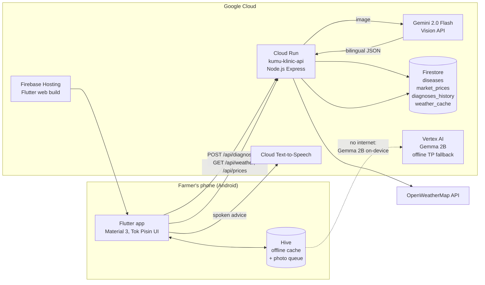

# Kumu Klinic — Architecture

## Data flow — diagnosis

1. Farmer photographs a diseased pod/leaf.
2. App base64-encodes and POSTs to Cloud Run.
3. Cloud Run calls **Gemini 2.0 Flash** (vision) with the PNG-expert prompt.
4. Gemini returns structured JSON: disease, confidence, EN + Tok Pisin advice.
5. Result saved to `diagnoses_history` in Firestore, returned to the app
   (target < 5 s online).
6. App renders the result card; **TTS** reads the Tok Pisin advice aloud.

## Offline path

- Disease library ships inside the app (`assets/diseases.json`) and is
  refreshed into Hive whenever the API is reachable.
- If `/api/diagnose` fails, the photo is queued in Hive and uploaded on
  reconnect. Library + history remain fully usable offline.
- For on-device translation fallback, **Gemma 2B via Vertex AI / AI Edge**
  is the planned offline model for Tok Pisin when the phone has no signal.

## Collections

| Collection | Writes | Purpose |
|---|---|---|
| `diseases` | seed script | 15+ PNG crop diseases, EN + TP fields |
| `market_prices` | seed/admin | price list shown in Weather & Market tab |
| `diagnoses_history` | API | every diagnosis, for analytics & retraining |
| `weather_cache` | API | cached forecasts per province |
